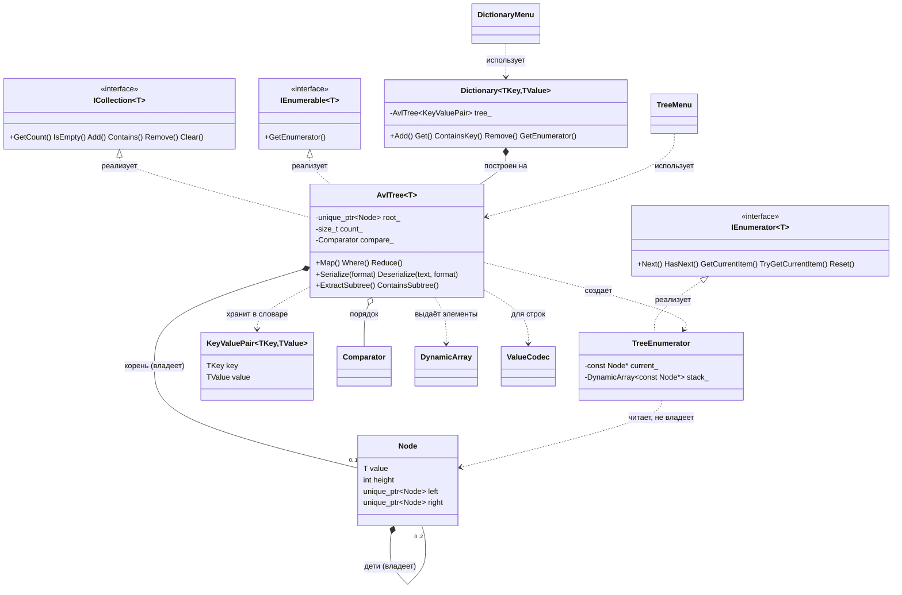
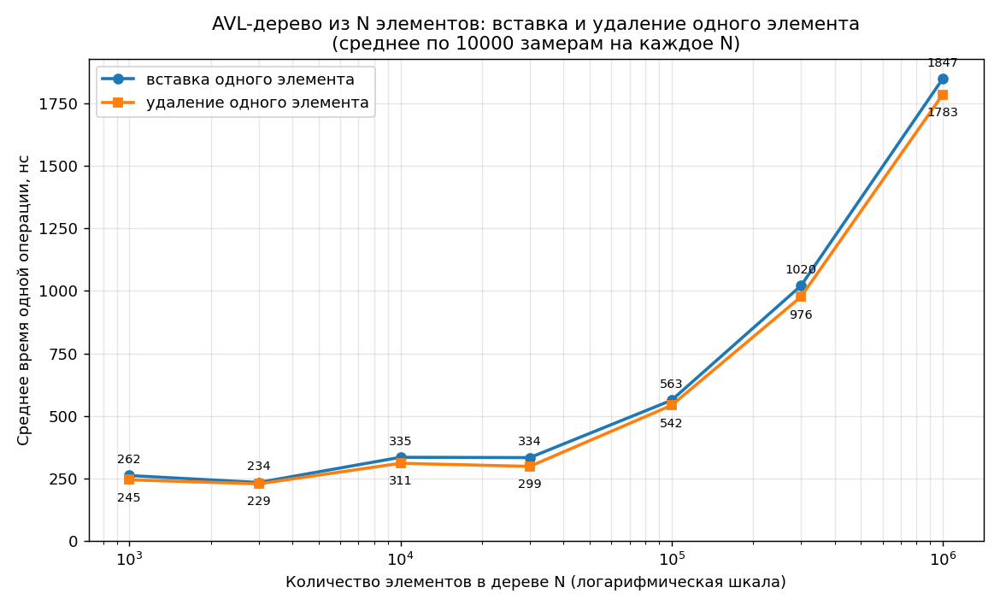

# ЛР-1. AVL-дерево и словарь на его основе

Техническое задание и описание системы.

## 1. Назначение

Программа на C++17 хранит данные в **AVL-дереве** (самобалансирующемся бинарном дереве поиска) и строит на нём **словарь** (ключ → значение). В программе есть консольное меню для ручной проверки, модульные тесты на Google Test и замеры скорости с графиком.

Балансировка нужна потому, что обычное дерево поиска на упорядоченных данных (1, 2, 3, …) вытягивается в «палку», и поиск превращается в перебор всех элементов. AVL-дерево выравнивается само после каждой вставки и удаления, поэтому поиск, вставка и удаление всегда занимают O(log N).

## 2. Выбранные пункты задания

| Пункт | Что | Баллы |
|---|---|---|
| 1 | бинарное дерево поиска: вставка, поиск, удаление | 5 |
| 1.1 | балансировка (AVL) | 2 |
| 1.2 | map, reduce, where | 3 |
| 1.4.2 | сохранение в строку по обходу, заданному строкой форматирования (`{К}(Л)[П]`) | 3 |
| 1.5.2 | чтение из строки по обходу, заданному строкой форматирования | 4 |
| 1.6 | извлечение поддерева (по заданному корню) | 2 |
| 1.7 | поиск на вхождение поддерева | 3 |
| 7.1 | интерфейс `ICollection` | 2 |
| 7.2 | `IEnumerable`, реализация `TreeEnumerator` | 3 |
| 7.3 | перегрузка операторов `==`, `!=`, `<<` | 2 |
| | **итого** | **29** (минимум 25) |

Сверх таблицы сделано: фиксированный формат строки КЛП (1.4.1, 1.5.1), словарь `Dictionary<TKey, TValue>` по спецификации `IDictionary` (Get, ContainsKey, Add, Remove, Count), компаратор в конструкторе, обход в порядке, заданном строкой, методы `TryFind` / `TryGet`.

Пункты связаны между собой: формат-строка использует тот же обход, что и `Traverse`, а перечислитель и словарь пригодятся в ЛР-2.

## 3. Сущности

| Сущность | Что это | Что хранит | Для чего |
|---|---|---|---|
| `ICollection<T>` | интерфейс «коллекция» | ничего, только методы GetCount, IsEmpty, Add, Contains, Remove, Clear | общий вид любой коллекции: код работает с деревом, не зная, что это AVL |
| `IEnumerable<T>` | интерфейс «коллекцию можно перебрать» | ничего, один метод `GetEnumerator()` | обещание выдать **итератор** |
| `IEnumerator<T>` | **интерфейс итератора** (перечислителя) | ничего, методы Next, HasNext, GetCurrentItem, TryGetCurrentItem, Reset | единый способ перебирать элементы любой коллекции |
| `AvlTree<T>` | AVL-дерево, главный класс, реализует `ICollection` и `IEnumerable` | корень, количество элементов, компаратор | хранить элементы по порядку и находить, добавлять, удалять их за O(log N) |
| `Node` (внутри `AvlTree`) | узел дерева | значение, высоту своего поддерева, левого и правого ребёнка | одна «ячейка» дерева; высота нужна для балансировки |
| `TreeEnumerator` (внутри `AvlTree`) | **итератор дерева**, реализует `IEnumerator` | указатель на корень, текущий узел, стек ещё не посещённых узлов | обойти дерево по возрастанию по одному элементу, без рекурсии |
| `Format` (внутри `AvlTree`) | разобранная строка формата `{К}(Л)[П]` | три открывающие скобки, три части (К/Л/П), три закрывающие скобки | разобрать формат один раз и потом по нему писать и читать строку |
| `Comparator` | функция сравнения `int(a, b)` | правило порядка: < 0 — a раньше, 0 — равны, > 0 — a позже | задать, как сравнивать элементы (по возрастанию, по убыванию, строки как числа) |
| `Dictionary<TKey, TValue>` | словарь (ассоциативный массив) | AVL-дерево из пар ключ–значение | быстро находить значение по ключу (слово → перевод) |
| `KeyValuePair<TKey, TValue>` | одна запись словаря | ключ и значение | элемент, который лежит в дереве словаря |
| `DynamicArray<T>` | свой динамический массив | элементы и размер | вернуть элементы списком (`ToArray`, `GetKeys`) и хранить стек итератора |
| `ValueCodec<T>` | перевод значения в текст и обратно | ничего, только правила | сохранение в строку и чтение из строки для `int`, `double`, `string` |
| Исключения | `TreeException` и наследники | текст ошибки | сообщить об ошибке (нет элемента, неверная строка и т. п.) |
| Меню (`TreeMenu<T>`, `DictionaryMenu`) | консольный интерфейс | текущее дерево или словарь | ручная проверка всех операций |
| Замеры (`Benchmark`) | измерение времени | результаты замеров | время вставки и удаления одного элемента при разных N: таблица в консоли и график через Python (`plot.py`) |


## 4. Связи между сущностями и их смысл



| Связь | Вид | Смысл |
|---|---|---|
| `AvlTree` → `ICollection`, `IEnumerable` | реализация интерфейса (наследование) | дерево обещает уметь всё, что требует интерфейс. С деревом можно работать через ссылку `ICollection<T>&`, не зная, что внутри AVL |
| `TreeEnumerator` → `IEnumerator` | реализация интерфейса | перечислитель дерева устроен как любой другой перечислитель |
| `AvlTree` → `TreeEnumerator` | создание | `GetEnumerator()` создаёт новый перечислитель и отдаёт его в `unique_ptr`, то есть владельцем становится вызывающий код |
| `TreeEnumerator` → `Node` | использование (не владеет) | перечислитель только читает узлы через обычные указатели и ничего не удаляет. Пока он работает, дерево менять нельзя |
| `AvlTree` → корневой `Node` | композиция (владение) | дерево владеет корнем: если удалить дерево, удалится и корень |
| `Node` → `left`, `right` | композиция (владение), 0..2 | у каждого узла ровно один родитель, и родитель владеет детьми: удалили узел, и вместе с ним удалилось всё поддерево. Сделано через `std::unique_ptr` |
| `AvlTree` → `Comparator` | агрегация (копия функции) | задаёт порядок элементов. Передаётся в конструктор и после создания не меняется |
| `Dictionary` → `AvlTree<KeyValuePair>` | композиция | словарь — обёртка над деревом пар. Компаратор пар сравнивает только ключи, поэтому ключи уникальны и упорядочены |
| `AvlTree` → `DynamicArray` | использование | `ToArray`, `GetKeys`, `GetValues` возвращают элементы по порядку. Стек перечислителя тоже лежит в `DynamicArray` |
| `AvlTree` → `ValueCodec` | использование | нужен при сохранении в строку и чтении из строки |
| `AvlTree` → исключения | использование | при неверных данных выбрасываются исключения (раздел 7) |
| меню и замеры → дерево, словарь | использование | меню вызывает методы, а само данные не хранит |

**Инварианты** — условия, которые выполняются всегда, после любой операции:
1. Дерево поиска: всё в левом поддереве меньше узла, всё в правом больше (по компаратору). Повторов нет.
2. AVL: в каждом узле высоты левого и правого поддеревьев отличаются не больше чем на 1.
3. Поле `height` в каждом узле равно настоящей высоте его поддерева.
4. `count_` равен числу узлов.

## 5. Функциональные требования (что система делает)

**Дерево `AvlTree<T>`**
* ФТ-1. Хранит элементы любого типа `T`, для которого задан компаратор (по умолчанию `<`). Проверено на `int`, `double`, `std::string`.
* ФТ-2. `Add(x)` добавляет элемент и возвращает `true`. Повтор не добавляется, тогда возвращается `false`.
* ФТ-3. После каждой вставки и удаления дерево балансируется поворотами (малый левый, малый правый и два двойных).
* ФТ-4. Элемент ищут `Contains(x)`, `TryFind(x, found)`, `Find(x)`.
* ФТ-5. `Remove(x)` удаляет элемент. Если его нет, выбрасывается `ElementNotFound`.
* ФТ-6. Есть `GetCount`, `IsEmpty`, `GetHeight`, `GetRoot`, `Clear`, `IsBalanced`.
* ФТ-7. `ToArray()` выдаёт элементы по возрастанию. `Traverse("КЛП", действие)` обходит дерево в порядке, заданном строкой из К/Л/П (или N/L/R).
* ФТ-8. `Map(f)` и `Where(условие)` строят новое дерево, `Reduce(f, c)` сворачивает элементы в одно значение. Исходное дерево не меняется.
* ФТ-9. `ExtractSubtree(x)` возвращает копию поддерева с корнем `x`. `ContainsSubtree(t)` проверяет, есть ли в дереве поддерево той же формы с теми же значениями.
* ФТ-10. `Serialize()` и `Deserialize(строка)` сохраняют и читают дерево в фиксированном формате КЛП: `значение(левое)(правое)`, например `2(1()())(3()())`.
* ФТ-11. `Serialize(формат)` сохраняет дерево по строке форматирования. Формат состоит из трёх групп «скобка, буква, скобка», где К — значение, Л — левое поддерево, П — правое. Порядок групп задаёт обход. Например, `{К}(Л)[П]` даёт `{2}({1}()[])[{3}()[]]`, а `(Л)[П]<К>` даёт обход ЛПК. Пустое поддерево записывается пустыми скобками. Скобки внутри значения экранируются через `\`.
* ФТ-12. `Deserialize(строка, формат)` читает дерево по той же строке форматирования и проверяет, что результат является деревом поиска и сбалансирован.
* ФТ-13. Неверный формат (не та буква, буква дважды, не три группы, одинаковые открывающая и закрывающая скобки) приводит к `TreeException`.
* ФТ-14. Дерево реализует `ICollection<T>`, и с ним можно работать через ссылку на интерфейс.
* ФТ-15. `GetEnumerator()` возвращает перечислитель, который проходит элементы по возрастанию: `Next()` переходит к следующему, `GetCurrentItem()` выдаёт текущий (до первого `Next()` и после конца выбрасывается `IndexOutOfRange`), есть также `HasNext()`, `TryGetCurrentItem()`, `Reset()`.
* ФТ-16. Операторы `==` и `!=` (деревья равны, если в них одинаковые элементы) и `<<` (печать вида `{1, 2, 3}`).
* ФТ-17. Копирование глубокое, перемещение передаёт узлы без копирования.

**Словарь `Dictionary<TKey, TValue>`**
* ФТ-18. `Add(key, value)` добавляет запись. Если ключ уже есть, значение заменяется.
* ФТ-19. `Get(key)` возвращает значение, а при отсутствии ключа выбрасывает `KeyNotFound`. `TryGet(key, value)` делает то же без исключения.
* ФТ-20. Есть `ContainsKey`, `Remove` (выбрасывает `KeyNotFound`, если ключа нет), `GetCount`, `Clear`.
* ФТ-21. `GetKeys()` выдаёт ключи по возрастанию, `GetValues()` — значения в порядке ключей, `GetEnumerator()` — записи в порядке ключей.
* ФТ-22. Порядок ключей можно задать своим компаратором (например, сравнивать строки как числа).

**Интерфейс и замеры**
* ФТ-23. Консольное меню: выбор типа (`int`, `double`, `string`) и все операции дерева, в том числе сохранение и чтение по формату и проход перечислителем по шагам. Отдельное меню словаря «слово → перевод». Печать формы дерева.
* ФТ-24. Замеры: среднее время вставки и удаления одного элемента в дереве из N элементов для разных N (много отдельных замеров на каждое N). Результаты выводятся таблицей в консоли, сохраняются в `results.csv` и рисуются графиком `benchmark.png` через Python (пункты 5 и 6 главного меню).

## 6. Нефункциональные требования (какой система должна быть)

* НФТ-1. **Скорость.** Вставка, поиск и удаление занимают O(log N) в худшем случае. Высота дерева не больше примерно 1,44·log₂N (для миллиона элементов не больше 28). Один шаг перечислителя в среднем занимает O(1), весь проход — O(N).
* НФТ-2. **Память.** Утечек нет. Каждым узлом владеет ровно один `std::unique_ptr`, ручных `delete` в дереве нет. Это проверяют тесты на утечки и AddressSanitizer с UndefinedBehaviorSanitizer (они включены в сборке тестов). Перечислителю нужна память O(высоты) = O(log N).
* НФТ-3. **Безопасность при исключениях.** Если исключение выброшено на середине операции (ошибка в строке, ошибка копирования элемента), уже созданные узлы освобождаются, а дерево остаётся корректным.
* НФТ-4. **Надёжность интерфейса.** Неверный ввод в меню не роняет программу: выводится сообщение об ошибке.
* НФТ-5. **Ограничения.** C++17, шаблоны и ООП. Контейнеры STL не используются, вместо них `DynamicArray`.
* НФТ-6. **Расширяемость.** Общие интерфейсы `ICollection`, `IEnumerable`, `IEnumerator` позволяют подменить реализацию (например, на хеш-таблицу в ЛР-2), не меняя код, который ими пользуется.
* НФТ-7. **Среда.** Ubuntu (WSL), g++, CMake, Google Test.
* НФТ-8. **Тестируемость.** Основные алгоритмы покрыты тестами, в каждом тесте одна проверка. Тест печатает номер, название, вход, ожидаемое, полученное и итог.

## 7. Обработка ошибок

| Ситуация | Исключение |
|---|---|
| удаление или извлечение отсутствующего элемента | `ElementNotFound` |
| нет ключа в словаре (`Get`, `Remove`) | `KeyNotFound` (наследник `ElementNotFound`) |
| корень пустого дерева | `EmptyTree` |
| неверная строка при чтении (в обоих форматах) | `ParseError` (для ошибок в скобках — с позицией символа) |
| строка прочитана, но это не дерево поиска или оно не сбалансировано; неверная строка формата; пустой компаратор; неверный порядок обхода | `TreeException` |
| выход за границы массива; текущий элемент перечислителя до `Next()` или после конца | `IndexOutOfRange` |

## 8. Тестирование

Google Test, 127 тестов, в каждом одна проверка. Группы тестов: базовые операции, map/where/reduce, поддеревья, строки, другие типы, компаратор и обходы, утечки памяти, AVL (все четыре вида поворотов; 1000 чисел по возрастанию дают высоту 10; 20 000 случайных операций без потери баланса), словарь, строки по формату (разные порядки, латиница, скобки внутри значений, неверные форматы и строки), перечислитель и `ICollection` (порядок, пустое дерево, границы, `Reset`, 1000 элементов, словарь, утечки), операторы `==` и `!=` (одинаковые деревья с разным порядком вставки, разные деревья). Оператор `<<` проверяет тест 56. Граничные случаи: пустое дерево (размер, высота, корень, поиск, удаление, обход, строка), один элемент, отсутствующий элемент, повтор, ноль и отрицательные числа, `INT_MIN` / `INT_MAX` (порядок и строка туда-обратно), переполнение `int` при чтении из строки (`ParseError`), границы перечислителя.

## 9. Замеры

Пункт меню «Замеры скорости» измеряет время вставки и удаления **одного** элемента в дереве из N элементов (по умолчанию N = 1000, 3000, 10 000, 30 000, 100 000, 300 000, 1 000 000):

1. Строится дерево из N случайно перемешанных чётных чисел (это время не замеряется).
2. **Вставка одного элемента:** берётся случайное нечётное число (его в дереве нет), засекается только `Add`. Затем без замера это число удаляется — в дереве снова ровно N элементов.
3. **Удаление одного элемента:** берётся случайное существующее (чётное) число, засекается только `Remove`. Затем без замера оно вставляется обратно — в дереве снова ровно N элементов.
4. Шаги 2–3 повторяются 1000 раз на каждом дереве, а всё вместе — на 10 разных случайных деревьях. Итог для каждого N — среднее по 10 000 замерам вставки и 10 000 замерам удаления, каждый раз в дереве ровно из N элементов. Перед замерами делается один прогон-«разогрев», который не учитывается.

Программа меню собирается с `-O2` и без санитайзера. Результат выводится таблицей в консоли и сохраняется в `results.csv`, а затем программа сама вызывает `python3 plot.py`, который рисует график `benchmark.png` (matplotlib): время одной операции в наносекундах от N, две линии (вставка и удаление), по оси N логарифмическая шкала, у точек подписаны значения. Пункт 6 снова показывает таблицу последних замеров и перерисовывает график. Скрипт можно запустить и вручную: `python3 plot.py results.csv benchmark.png`.

**Результаты** (среднее время одной операции, нс; 10 000 замеров на каждое N):

| N | вставка одного элемента, нс | удаление одного элемента, нс |
|---:|---:|---:|
| 1 000 | 262 | 245 |
| 3 000 | 234 | 229 |
| 10 000 | 335 | 311 |
| 30 000 | 334 | 299 |
| 100 000 | 563 | 542 |
| 300 000 | 1 020 | 976 |
| 1 000 000 | 1 847 | 1 783 |



*График замеров: время вставки и удаления одного элемента в зависимости от N (ось N логарифмическая).*

**Вывод.** До N ≈ 3·10⁴ время одной операции почти не растёт: число шагов вниз по дереву растёт как log N, а всё дерево помещается в кеш процессора. С N = 10⁵ время растёт быстрее: дерево перестаёт помещаться в кеш, и шаги по нижним уровням требуют обращения к оперативной памяти. При росте N в 1000 раз (с 10³ до 10⁶) время одной операции выросло лишь примерно в 7 раз, что соответствует логарифмической сложности AVL-дерева. Вставка и удаление занимают почти одинаковое время: обе операции состоят из спуска на высоту дерева и перебалансировки на обратном пути.

## 10. Сборка и запуск

Нужны `cmake`, `g++` и Google Test (`sudo apt install libgtest-dev`), для графика — Python 3 с matplotlib (`sudo apt install python3-matplotlib`).

```bash
cmake -B build
cmake --build build
./Laba1     # меню
./Tests     # тесты
```

## 11. Структура

```
include/   AvlTree.hpp, Dictionary.hpp, Interfaces.hpp, DynamicArray.hpp, Exceptions.hpp, ValueCodec.hpp, Benchmark.hpp
src/       main.cpp, Benchmark.cpp, tests.cpp
plot.py    график замеров (Python, matplotlib): results.csv → benchmark.png
results.csv, benchmark.png — результаты последних замеров
```

## 12. Как открыть это описание в VS Code

1. Открыть папку проекта (`File → Open Folder…`) и в ней файл `README.md`.
2. Нажать `Ctrl+Shift+V` — описание откроется в режиме просмотра (с таблицами и графиком). Или `Ctrl+K`, затем `V` — просмотр откроется рядом с текстом.
3. Чтобы в просмотре рисовалась диаграмма из раздела 4, установить расширение **Markdown Preview Mermaid Support** (`bierner.markdown-mermaid`): `Ctrl+Shift+X` → поиск по названию → Install.

На GitHub описание, таблицы, диаграмма и график отображаются сразу.
